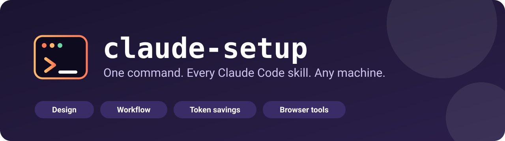

<p align="center">
  
</p>

<p align="center">
  <a href="LICENSE"></a>
  
  
  
</p>

# claude-setup

My Claude Code skills and plugins, installed with a single command. Set up a new laptop, a server, or a WSL box in a minute and get the same toolbox every time.

## Quick start

**1. Install Claude Code** if you do not have it yet. The desktop app works; so does the CLI:

```bash
curl -fsSL https://claude.ai/install.sh | bash
```

Open a new terminal and run `claude` once to sign in.

**2. Run the installer.** This repository is private, so sign in to GitHub first (`gh auth login`), then:

```bash
gh api repos/adityaoryza/claude-setup/contents/install.sh -H "Accept: application/vnd.github.raw" | bash
```

If you make the repository public, this works without signing in:

```bash
curl -fsSL https://raw.githubusercontent.com/adityaoryza/claude-setup/main/install.sh | bash
```

**3. Restart Claude Code**, then check:

```bash
claude plugin list
```

To pass options through a pipe, add `-s --` after `bash`, for example `... | bash -s -- --all`.

## What you get

### Interface design

| Name | What it does | Source |
| --- | --- | --- |
| `frontend-design` | Official Anthropic skill: a committed visual direction, a real type scale, and a spacing system instead of generic output. | [anthropics/claude-plugins-official](https://github.com/anthropics/claude-plugins-official/tree/main/plugins/frontend-design) |
| `designer-skills` | A staged design process: `/grill-me`, `/design-brief`, `/information-architecture`, `/design-tokens`, `/brief-to-tasks`, `/frontend-design`, `/design-review`, plus `/design-flow` to run them in order. | [julianoczkowski/designer-skills](https://github.com/julianoczkowski/designer-skills) |
| `ui-ux-pro-max` | Picks palettes, fonts, and design rules to fit the kind of project. Needs Python 3; its scripts make no network calls. | [nextlevelbuilder/ui-ux-pro-max-skill](https://github.com/nextlevelbuilder/ui-ux-pro-max-skill) |
| `impeccable` | 24 design commands (`/impeccable polish`, `audit`, `critique`, ...) and detection of common "AI slop" patterns. | [pbakaus/impeccable](https://github.com/pbakaus/impeccable) |
| `skillui` | CLI that extracts a design system from a website, repo, or folder into files Claude reads. | [amaancoderx/npxskillui](https://github.com/amaancoderx/npxskillui) |
| `playwright-cli` | Lets Claude open a browser and screenshot its own work. | [Playwright docs](https://playwright.dev/agent-cli/skills) |

### Engineering workflow

| Name | What it does | Source |
| --- | --- | --- |
| `superpowers` | The end-to-end flow: `brainstorming`, `writing-plans`, `executing-plans`, `test-driven-development` (red-green-refactor), `systematic-debugging`, `verification-before-completion`, `requesting-code-review`, `using-git-worktrees`, `subagent-driven-development`, `finishing-a-development-branch`. Skills trigger automatically. | [obra/superpowers](https://github.com/obra/superpowers) |
| `code-review` | `/code-review` runs 4 parallel agents on a pull request and posts only findings scored 80 or higher. Needs the GitHub CLI signed in (`gh auth login`). | [official plugin](https://github.com/anthropics/claude-plugins-official/tree/main/plugins/code-review) |
| `commit-commands` | Commit, push, and open a pull request with one command. | [official plugin](https://github.com/anthropics/claude-plugins-official/tree/main/plugins/commit-commands) |
| `feature-dev` *(optional)* | `/feature-dev` runs a guided 7-phase flow: discovery, codebase exploration, clarifying questions, architecture design, implementation, review, summary. No hooks. Overlaps with `superpowers`. | [official plugin](https://github.com/anthropics/claude-plugins-official/tree/main/plugins/feature-dev) |
| `security-guidance` *(optional)* | Warns on risky patterns when files are edited, reviews each turn's diff, and reviews commits. Installs hooks and sends diff hunks to the model. | [official plugin](https://github.com/anthropics/claude-plugins-official/tree/main/plugins/security-guidance) |

### Working style

| Name | What it does | Source |
| --- | --- | --- |
| `ponytail` | A "lazy senior dev" persona: skip what nobody asked for, reuse what exists, never cut validation, security, or accessibility, and end each reply by stating what was skipped. | [DietrichGebert/ponytail](https://github.com/DietrichGebert/ponytail) |

### Token savings

| Name | What it does | Source |
| --- | --- | --- |
| `caveman` | Makes Claude write tersely while keeping code and commands intact. | [JuliusBrussee/caveman](https://github.com/JuliusBrussee/caveman) |
| `rtk` *(optional)* | CLI proxy that condenses shell output before it reaches the context. Global hook for the Bash tool. | [rtk-ai/rtk](https://github.com/rtk-ai/rtk) |
| `context-mode` *(optional)* | Keeps large tool output in a local database and sends only a summary. Installs 6 hooks and an MCP server. | [mksglu/context-mode](https://github.com/mksglu/context-mode) |

Usage reports are not installed; run them when you need them: `npx ccusage@latest` ([ryoppippi/ccusage](https://github.com/ryoppippi/ccusage)).

Everything above is installed by default except the items marked optional. Add them with `--all`.

## Options

```bash
bash install.sh                         # standard set
bash install.sh --all                   # standard set plus the optional items
bash install.sh --only impeccable,rtk   # only these
bash install.sh --skip skillui          # standard set without these
bash install.sh --list                  # show what is available
DRY_RUN=1 bash install.sh               # print the commands, install nothing
```

| Variable | Effect |
| --- | --- |
| `DRY_RUN=1` | Print every command without running it. |
| `NO_TELEMETRY_CONFIG=1` | Do not edit `~/.claude/settings.json` (see the Impeccable note below). |
| `CLAUDE_BIN=/path/to/claude` | Use a specific Claude Code binary. |

A suggested flow with the standard set: design (`designer-skills`, `impeccable`) → brainstorm and plan (`superpowers`) → test-first implementation (`superpowers`) → review (`code-review`) → commit (`commit-commands`).

## How it works

- **Finds Claude Code for you.** It uses `claude` on your `PATH`, or the CLI bundled with the desktop app, or the path in `CLAUDE_BIN`. If none exists it prints the install command and stops.
- **Safe to re-run.** Already-installed plugins are not an error, and a summary lists what was installed, skipped, or failed. The exit code is non-zero if anything failed.
- **No `sudo`.** If the global npm folder is not writable, npm CLIs go to `~/.npm-global` instead, and the script tells you how to add it to your `PATH`.
- **Plugins install at user scope**, so they apply to every project on the machine.

## Read this before installing

- **Impeccable installs hooks.** They run a local launcher on UI file edits and when a session stops, and may download an engine to `~/.impeccable`. Its anonymous telemetry is on by default, so this script turns it off by adding `DO_NOT_TRACK=1` and `IMPECCABLE_NO_TELEMETRY=1` to the `env` block of `~/.claude/settings.json`. A backup is saved as `settings.json.bak`. Skip this with `NO_TELEMETRY_CONFIG=1`.
- **`superpowers` changes how Claude works in every session.** Its skills trigger automatically and are meant as mandatory workflows (for example, test-first development), not suggestions. Its README does not fully describe its hooks, so read the repository before relying on it.
- **`superpowers` and `feature-dev` overlap** (both clarify, design, and review), and `superpowers` also overlaps with `/grill-me` from `designer-skills`. Pick one as your main driver. `superpowers` is the default here; `feature-dev` is kept optional for exploring an unfamiliar codebase.
- **`security-guidance` installs hooks and sends diffs to the model** at the end of each turn and on commit, which adds usage. Disable parts with `ENABLE_STOP_REVIEW=0` or `ENABLE_COMMIT_REVIEW=0`, or everything with `SECURITY_GUIDANCE_DISABLE=1`. It is a best-effort aid, not a replacement for human review or SAST.
- **`rtk` and `context-mode` are optional** because they change how Claude works everywhere: rtk rewrites Bash commands through a hook, and context-mode registers 6 hooks and an MCP server. They solve a similar problem, so try one first. `rtk init -g` is interactive and is left as a manual step.
- **`caveman` and `ponytail` both change Claude's style in every session.** They work together, but if replies feel too terse, remove one.
- **Two skills are named `frontend-design`** (the official one and the one in `designer-skills`). Each lives in its own plugin namespace and they can overlap. If that is confusing, remove one: `claude plugin uninstall frontend-design@claude-plugins-official`.
- **Third-party skills are instructions that steer Claude.** Read a skill's `SKILL.md` before adding a new one.

## Update and remove

```bash
claude plugin marketplace update            # refresh every marketplace listing
claude plugin update caveman@caveman        # update one plugin
claude plugin uninstall caveman@caveman     # remove one plugin
npm uninstall -g skillui @playwright/cli    # remove the npm CLIs
```

Plugin command syntax can differ between Claude Code versions; check `claude plugin --help`.

## Add your own

1. Add a function `s_yourname()` to `install.sh` (copy the pattern of `s_caveman`).
2. List the name in `STANDARD` or `OPTIONAL`.
3. Call it with `step yourname s_yourname`.
4. Add a row to the right table above.

## License

[MIT](LICENSE) for this repository. Each skill and plugin keeps its own license; see the Source column.
